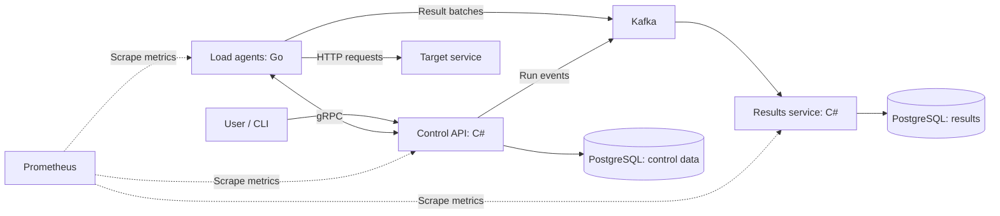

# LatencyStorm

**Distributed load testing platform for HTTP services.**

[English](#english) | [Русский](#русский)

## English

LatencyStorm is a platform for distributed load testing of HTTP services. It coordinates multiple load-generating agents, runs test scenarios, and combines their measurements into a single report.

The project explores microservice architecture, communication between C# and Go services, event-driven processing, fault handling, and observability.

### Project status

MVP stage 1 provides versioned protobuf contracts, protocol and measurement specifications, and verified C# / Go compatibility. Application services and the local infrastructure are planned for later stages. See [contracts](contracts/README.md), [protocol](docs/protocol-v1.md), [measurements](docs/measurements-v1.md), and [pinned versions](docs/toolchain.md).

To generate and verify contracts, run `python scripts/verify-contracts.py` from the repository root with Python 3.9+ and Docker Desktop using Linux containers. Host .NET, Go, and protoc installations are not required. The first run downloads SDK images and dependencies.

### Planned architecture

| Component | Technology | Responsibility |
| --- | --- | --- |
| Control API | C# / ASP.NET Core | Manage scenarios and runs, assign work to agents, and track execution state |
| Load agents | Go | Generate HTTP traffic at a configured rate, measure responses, and publish result batches |
| Results service | C# | Consume result batches, aggregate measurements, and store reports |
| Event streaming | Kafka | Transport run events and batched measurements |
| Agent communication | gRPC | Exchange assignments, readiness signals, heartbeats, and stop commands |
| Persistence | PostgreSQL | Store scenarios, runs, agent assignments, and historical results |
| Monitoring | Prometheus | Collect service health and load-generation metrics |
| Local environment | Docker / Docker Compose | Run services and infrastructure locally |

The Control API and Results service will own their respective data. Historical test reports will be stored in PostgreSQL, while Prometheus will provide operational monitoring.

### Planned MVP

- Define a single HTTP request per scenario: method, URL, headers, and optional body.
- Configure target requests per second (RPS), test duration, and request timeout.
- Distribute a test across multiple Go agents.
- Start and manually stop runs through the API.
- Report request counts, response codes, network errors, actual throughput, and p50/p95/p99 latency.
- Distinguish the requested load from the achieved load and track requests the agents could not start on schedule.
- Handle agent disconnections and duplicate result batches.
- Run locally with Docker Compose and a demo HTTP target with configurable delays and errors.

For example, a run could generate a total of 300 requests per second across three agents for two minutes, then produce a consolidated latency and error report.

### Engineering focus

- Rate-based load generation with bounded concurrency.
- Coordinated starts and bounded shutdown of agents.
- Batched measurements and mergeable latency histograms for aggregate percentiles.
- Idempotent result processing and explicit reporting of incomplete results.
- Monitoring that helps distinguish target-service limits from generator limits.

Possible extensions include load ramps, multi-step scenarios, automatic stop thresholds, and comparisons between runs.

### License

LatencyStorm is licensed under the [MIT License](LICENSE).

## Русский

LatencyStorm — платформа для распределённого нагрузочного тестирования HTTP-сервисов. Она координирует несколько агентов генерации нагрузки, выполняет тестовые сценарии и объединяет измерения в общий отчёт.

Проект предназначен для практического изучения микросервисной архитектуры, взаимодействия сервисов на C# и Go, событийной обработки, обработки сбоев и наблюдаемости.

### Статус проекта

В рамках этапа 1 MVP подготовлены версионируемые protobuf-контракты, спецификации протокола и измерений; совместимость C# / Go проверяется автоматически. Сервисы и локальная инфраструктура появятся на следующих этапах. См. [контракты](contracts/README.md), [протокол](docs/protocol-v1.md), [измерения](docs/measurements-v1.md) и [закреплённые версии](docs/toolchain.md).

Для генерации и проверки контрактов выполните `python scripts/verify-contracts.py` из корня репозитория с Python 3.9+ и Docker Desktop в режиме Linux containers. Устанавливать .NET, Go и protoc на хост не требуется. При первом запуске загружаются образы SDK и зависимости.

### Планируемая архитектура

| Компонент | Технология | Назначение |
| --- | --- | --- |
| Control API | C# / ASP.NET Core | Управление сценариями и запусками, распределение работы между агентами, отслеживание состояния |
| Агенты нагрузки | Go | Генерация HTTP-трафика с заданной интенсивностью, измерение ответов и отправка пакетов результатов |
| Сервис результатов | C# | Получение пакетов результатов, агрегация измерений и сохранение отчётов |
| Передача событий | Kafka | Доставка событий запусков и пакетов измерений |
| Связь с агентами | gRPC | Передача заданий, сигналов готовности, heartbeat-сообщений и команд остановки |
| Хранение данных | PostgreSQL | Сценарии, запуски, назначения агентов и история результатов |
| Мониторинг | Prometheus | Метрики состояния сервисов и генерации нагрузки |
| Локальное окружение | Docker / Docker Compose | Запуск сервисов и инфраструктуры на локальной машине |

Control API и сервис результатов будут владеть каждый своими данными. Исторические отчёты тестов будут храниться в PostgreSQL, а Prometheus будет использоваться для оперативного мониторинга. Схема взаимодействия компонентов приведена в английской части выше.

### Планируемый MVP

- Один HTTP-запрос в сценарии: метод, URL, заголовки и необязательное тело.
- Настройка целевого количества запросов в секунду (RPS), длительности теста и таймаута запроса.
- Распределение теста между несколькими агентами на Go.
- Запуск и ручная остановка через API.
- Отчёт с количеством запросов, кодами ответов, сетевыми ошибками, фактической интенсивностью и задержками p50/p95/p99.
- Раздельный учёт заданной и достигнутой нагрузки, а также запросов, которые агенты не смогли запустить по расписанию.
- Обработка отключений агентов и повторных пакетов результатов.
- Локальный запуск через Docker Compose и тестовый HTTP-сервис с настраиваемыми задержками и ошибками.

Например, тест сможет создавать суммарно 300 запросов в секунду силами трёх агентов в течение двух минут, после чего сформирует общий отчёт по задержкам и ошибкам.

### Инженерные задачи

- Генерация нагрузки с заданной интенсивностью и ограничением числа одновременных запросов.
- Согласованный старт и остановка агентов за ограниченное время.
- Передача измерений пакетами и объединение гистограмм задержек для расчёта общих перцентилей.
- Идемпотентная обработка результатов и явное отображение неполных данных.
- Мониторинг, позволяющий отличать ограничения тестируемого сервиса от ограничений генераторов.

В дальнейшем можно добавить плавное изменение нагрузки, многошаговые сценарии, пороговые условия автоматической остановки и сравнение запусков.

### Лицензия

LatencyStorm распространяется по [лицензии MIT](LICENSE).
